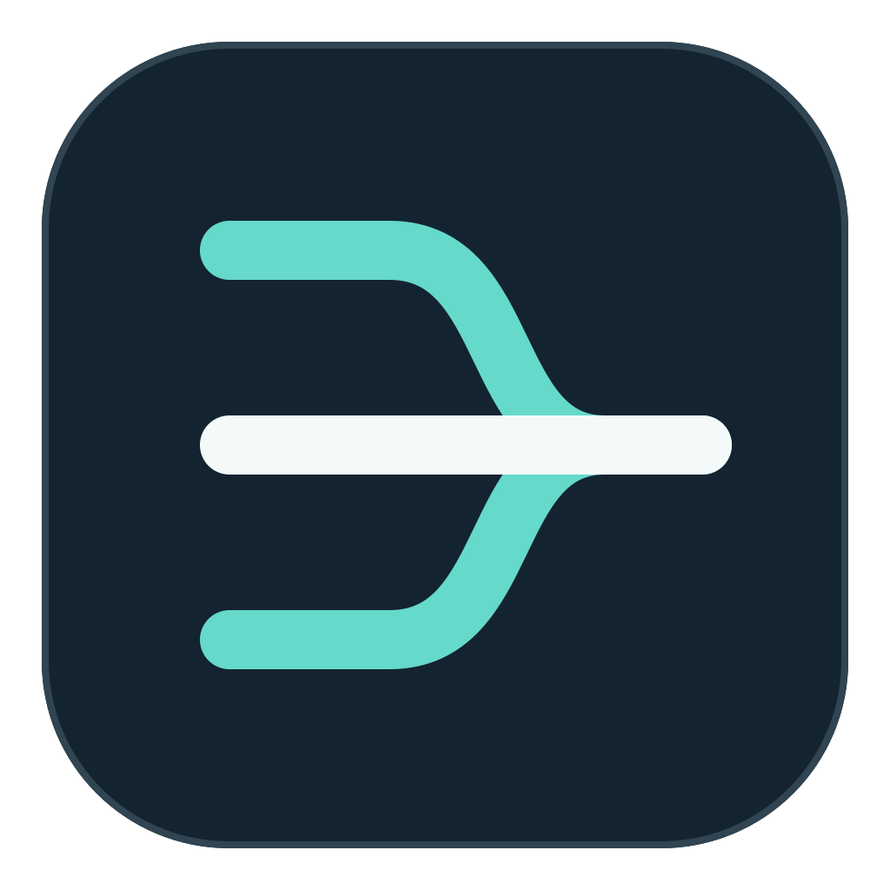
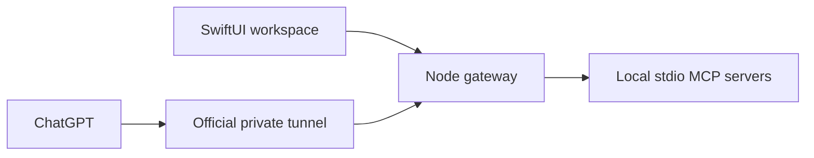

<p align="center"></p>

# One MCP

### Your local MCP tools. One native Mac workspace.

One MCP is a native macOS application for organizing local MCP servers, choosing which tools are exposed, and managing private outbound tunnels. Use one aggregated endpoint or a separate endpoint per server.

[简体中文](README.zh-CN.md) · [Quick start](docs/GETTING_STARTED.md) · [Architecture](docs/ARCHITECTURE.md) · [Validation](docs/TESTING.md)

> **Status:** active development. The TypeScript gateway has recorded Linux build and 35 fixture-based test passes. Native macOS compilation, Keychain behavior, the official tunnel client, and real ChatGPT end-to-end calls still require validation. No signed or notarized release is currently provided.

## What it does

- **Wrap a CLI deliberately** — select CLI service type, define explicit typed tools and bounded execution; see [CLI services](docs/CLI-SERVICES.md). No automatic arbitrary-command exposure.
- **Organize workspaces** — keep server configuration and credential namespaces separate between projects.
- **Import deliberately** — preview selected MCP JSON files, deduplicate candidates, and merge without copying secret values or starting processes.
- **Expose only selected tools** — per-server allowlists start empty; discovery and execution remain explicit operations.
- **Choose your topology** — aggregate tools at `/mcp`, or use individual `/servers/{id}/mcp` routes.
- **Manage tunnel lifecycle** — initialize profiles, run diagnostics, start/stop the official OpenAI tunnel client, and distinguish a running process from a healthy connection.
- **Keep credentials intentional** — session-only values by default, with explicit macOS Keychain save/load controls.

## How it fits together



The gateway listens on loopback. The official tunnel client makes an outbound connection; One MCP does not open a public inbound port or create credentials on your behalf. Actual access depends on your OpenAI account and workspace capabilities.

## Quick start

**Requirements:** macOS 26+, Xcode 26 / Swift 6.2, Node.js 22+, and the MCP programs you intend to run. The package uses Swift 5 language mode with the Swift 6.2 toolchain.

```sh
git clone https://github.com/zmnsQ/one-mcp.git
cd one-mcp
(cd gateway && npm ci --ignore-scripts && npm run build)
bash scripts/build-macos-app.sh
```

The build script produces an `.app` in a timestamped output directory; it does not launch it. Native compilation has not yet been verified. You can also open `Package.swift` in Xcode using the `MCPHarbor` scheme.

Next, follow [Getting started](docs/GETTING_STARTED.md) to configure executable paths, add a trusted MCP server, select a read-only tool, and verify one call before expanding access.

## Aggregate or individual

| Mode | Local route | Tunnel setup |
| --- | --- | --- |
| Aggregate | `/mcp` | One profile and tunnel for the selected tool catalog |
| Individual | `/servers/{id}/mcp` | A distinct profile and tunnel ID for each server |

Both local route families exist. The UI mode controls which tunnel arrangement you manage; it does not disable the other loopback route family.

## Scope and safety

One MCP currently proxies **tool listing and tool calls** for trusted local stdio servers. It does not proxy resources, prompts, roots, sampling, elicitation, or arbitrary remote HTTP upstreams, and does not provide multi-user isolation or OAuth for a shared gateway.

MCP processes run with the user's account permissions. A tool-name allowlist is not a filesystem sandbox, and cancellation cannot undo an already-completed side effect. Use a harmless read-only tool for first-run validation.

Configuration excludes secret values. Avoid secrets in arguments, names and paths, which may be persisted or visible in process listings. Logs are best-effort redacted; review them before sharing.

## Documentation

- [Getting started](docs/GETTING_STARTED.md): installation, first server, tunnel connection
- [Architecture](docs/ARCHITECTURE.md): components, lifecycle and protocol limits
- [Testing](docs/TESTING.md): reproducible gateway checks and native acceptance gaps
- [Detailed operations (中文)](docs/OPERATIONS.zh-CN.md): all configuration and recovery steps
- [Feature matrix](docs/FEATURE_MATRIX.zh-CN.md): capability-to-source mapping
- [Gateway guide](gateway/README.md): implementation-level details

## Development

```sh
cd gateway
npm ci --ignore-scripts --no-audit --no-fund
npm test
```

`npm test` builds the gateway and runs isolated MCP fixtures. It does not validate the native UI or connect to a real ChatGPT account. See [the recorded results](gateway/validation/RESULTS-2026-10-15.md).

The macOS workflow is manual-only. Confirm runner billing before triggering it; it does not sign, notarize, launch or deploy the app.

Internal Swift package/target names and application-support paths retain `MCPHarbor` for compatibility. The product name is **One MCP**.

## License

A project license has not yet been selected. Publishing the source does not grant an open-source license. The MCP TypeScript SDK and other dependencies retain their own licenses; the tunnel client is installed separately from its official source.

## Command line and AI agents

The native UI groups work into MCP Services, ChatGPT Connections and Settings; tool permissions live with each service. The CLI shares its workspace configuration and gateway; it does not maintain a second server registry. Start with `./bin/onemcp help` after building the gateway. Read the [CLI reference](docs/CLI.md) and install the optional [One MCP agent skill](skills/one-mcp/SKILL.md) in your chosen agent. Configuration mutations preview first and require an explicit revision on apply. Settings can discover existing official tunnel-client paths and profile metadata without copying credentials or executing candidates.


## Remote connection setup / 远程连接设置

The app includes staged OpenAI Tunnel onboarding, external OAuth resource-server protection, and Cloudflare Tunnel management. See [setup, security boundaries and compatibility](docs/REMOTE_CONNECTIONS.zh-CN.md). Real macOS and provider-account acceptance testing is required before production use.

## Independent tunnel records

Add named tunnel records and bind one or more MCP services to each. OpenAI and Cloudflare records have independent lifecycle and scoped routes; new MCP services are never implicitly added. See [configuration, migration and verification](docs/TUNNEL_RECORDS.md).
